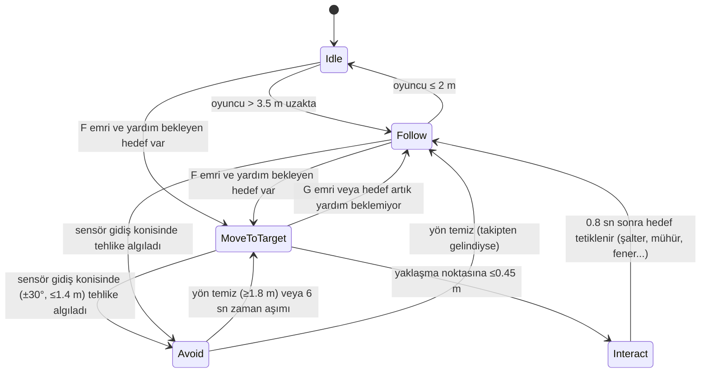
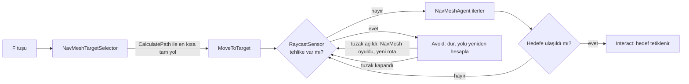

# Lumen — Unity Otonom Eşlikçi ve Yerel LLM Destekli NPC

> **Durum (6 Kasım 2026):** Oyun baştan sona oynanabilir durumda. Ana menü, hikâye koridoru, Lumi ile geçilen 1. bölüm ve kristal odaları, Ollama destekli bekçi Arven, kutsal bölümün iki sınavı ve oyun sonu tamamlandı. 53 PlayMode testinin 53'ü geçiyor (biri gerçek Ollama gerektirir).

| | |
| --- | --- |
| **Ders** | Yazılım Geliştirme Laboratuvarı I — Proje 1 |
| **Ekip** | Onur TOPBAŞ (Geliştirici 1), Ali Hamza TEKİNBAŞ (Geliştirici 2) |
| **Motor** | Unity 6000.6.7f1 (Built-in render pipeline), C# |
| **Yerel LLM** | Ollama 0.40, model `gemma3:4b` |
| **Teslim** | 6 Kasım 2026 |

## İçindekiler

1. [Giriş](#1-giriş)
2. [Oyun senaryosu](#2-oyun-senaryosu)
3. [Kurulum ve çalıştırma](#3-kurulum-ve-çalıştırma)
4. [Mimari](#4-mimari)
5. [Otonom eşlikçi (Lumi): karar mekanizması](#5-otonom-eşlikçi-lumi-karar-mekanizması)
6. [LLM destekli NPC (Arven)](#6-llm-destekli-npc-arven)
7. [Hata yönetimi stratejisi](#7-hata-yönetimi-stratejisi)
8. [Prompt injection savunması](#8-prompt-injection-savunması)
9. [Testler ve sonuçlar](#9-testler-ve-sonuçlar)
10. [Ekran görüntüleri](#10-ekran-görüntüleri)
11. [Görev dağılımı ve Git iş akışı](#11-görev-dağılımı-ve-git-iş-akışı)
12. [Sonuç, tartışma ve sınırlılıklar](#12-sonuç-tartışma-ve-sınırlılıklar)

---

## 1. Giriş

**Problem.** Oyunlarda yardımcı karakterler çoğu zaman önceden yazılmış rotaları izler, NPC'ler ise sabit diyalog ağaçlarından cevap verir. Bu projede iki bağımsız yapay zekâ bileşeni tek bir macera oyununda birleştirildi:

| Bileşen | Bizdeki karşılığı | Yaklaşım |
| --- | --- | --- |
| Otonom eşlikçi | **Lumi**, ışık saçan küçük robot | NavMesh yol bulma + açık durum makinesi (FSM) + Raycast sensörü |
| LLM destekli NPC | **Arven**, son kapıyı bekleyen taş bekçi | Aynı bilgisayardaki Ollama'dan, JSON şemasına zorlanmış canlı cevaplar |

**Amaç.** Lumi'nin hiçbir hareketi sabit bir komut dizisi değildir: hangi hedefe gideceğine NavMesh yol uzunluğuyla kendisi karar verir, tuzakları sensörüyle görüp rotasını yeniden hesaplar. Arven'in her sözü yerel modelden canlı gelir; modelin çıktısı serbest metin olarak değil, doğrulanmış JSON olarak oyun durumuna bağlanır. Model kapalıyken ya da bozuk cevap verdiğinde oyun çökmez.

> Ekip kararı: Pekiştirmeli öğrenme (ML-Agents) kullanılmadı; doküman NavMesh yaklaşımına izin vermektedir.

## 2. Oyun senaryosu

Birinci şahıs kameralı, yedi bölümlük bir macera. Oyuncu, ışığını yitirmiş yeraltı tapınağı Lumen'e iner. Yanında Lumi vardır.

| # | Bölüm | İçerik | Lumi'nin rolü | Sorumlu |
| --- | --- | --- | --- | --- |
| 0 | Ana menü | Oyna, Ayarlar (ses, ışık, tam ekran), Tuşlar, Çıkış | — | Geliştirici 2 |
| 1 | Giriş koridoru | Karanlık koridorda üç hikâye metni; koridor sonunda Lumi ile tanışma | Tanışmaya kadar bekler, sonra takibe başlar | G1 (koridor), G2 (hikâye) |
| 2 | Fiziksel engel | Köprü kalkık, altında lav. Şalter, yalnızca Lumi'nin sığdığı tünelin ardındaki tuzak odasında | F ile şaltere gider, açılıp kapanan dikenleri sensörüyle atlatır, köprüyü indirir | Geliştirici 1 |
| 3 | Kristal galerisi | 3 kristal odası ve 3 yazıt. 3 kristal kapıyı açar | Karanlık odada güvenli yolu aydınlatır, labirentte şalterli kapıları açar, diken odasında ikinci plakaya basar | Geliştirici 1 |
| 4 | Bekçi Arven | Serbest metinle sohbet. Güven 30'a ulaşınca kapı açılır (kristaller ve yazıtlar bitmeden en fazla 29) | — | Geliştirici 2 |
| 5 | Kutsal bölüm | **İkiz Mühür:** iki mühür aynı anda yanmalı. **Işığın Yolu:** lavın üstünde yalnızca Lumi'nin ışığında görünen yol | Oyuncunun sığmadığı nişteki mührü şarj eder; fenere giderek yolu aydınlatır | Geliştirici 2 |
| 6 | Tapınağın kalbi | Bitiş ekranı: süre, Arven'in güveni, Ana Menü | — | Geliştirici 2 |

**Kontroller:** WASD hareket, fare etrafa bakma, **E** etkileşim, **F** Lumi'den yardım iste, **G** Lumi beni takip etsin, **Enter** Arven'e gönder, **Tab** sohbeti kapat, **Esc** menü. Oyunda ekranda yalnızca F ipucu görünür; tüm tuşlar menüdeki **Tuşlar** panelindedir.

## 3. Kurulum ve çalıştırma

1. [Ollama](https://ollama.com)'yı kurun ve modeli indirin:
   ```bash
   ollama pull gemma3:4b
   ```
   Ollama arka planda `http://localhost:11434` adresinde çalışır. Ollama kapalıyken de oyun açılır; Arven "derin bir sessizliğe gömüldü" der.
2. Projeyi Unity **6000.6.7f1** ile açın. Sahne yoksa: **Lumen → Sahneyi Yeniden Oluştur**.
3. `Assets/_Project/Scenes/MainMenu.unity` sahnesini açıp Play'e basın.
4. Windows .exe almak için: **Lumen → Windows Build Al** → `Builds/Lumen/Lumen.exe` (oyun tam ekran açılır).
5. Testler: **Window → General → Test Runner → PlayMode → Run All** ya da
   ```bash
   Unity.exe -batchmode -projectPath . -runTests -testPlatform PlayMode
   ```

Paketler: `com.unity.ai.navigation` 2.0.16, `com.unity.ugui` 2.6.0, `com.unity.nuget.newtonsoft-json` 3.2.2, `com.unity.test-framework` 1.8.0. Girdi sistemi: eski Input Manager.

## 4. Mimari

### 4.1 Klasör yapısı

```text
Assets/_Project/
  Scripts/
    Core/        Ortak arayüzler: IInteractable, IActivatable, ICompanionTarget, ILoreJournal, IRespawnable, InputLock, GameLayers
    Companion/   Lumi: CompanionController, durum makinesi (StateMachine/), RaycastSensor, NavMeshTargetSelector   (G1)
    Level/       Şalter, köprü, tuzaklar, kristaller, yazıtlar, kristal odası bulmacaları                             (G1)
    Player/      Oyuncu, birinci şahıs kamera, etkileşim, HUD, mini harita, nişangah                                 (G1 + G2)
    NPC/         Ollama servisi, ayrıştırıcı, girdi filtresi, sohbet arayüzü, oyun durumu, Arven, bitiş ekranı      (G2)
    Sanctum/     Kutsal bölüm sınavları: TwinSeal, LightPath                                                          (G2)
    Menu/        Ana menü, duraklatma menüsü, ayarlar, tuşlar paneli                                                  (G2)
    Story/       Koridordaki hikâye metinleri                                                                         (G2)
    Audio/       Ses efektleri ve müzik geçişi                                                                        (G2)
  Editor/        Sahne üretici (SceneBuilding/), dokular (TempleTextures), müzik üretici, build ve ekran görüntüsü araçları
  Tests/PlayMode/  53 PlayMode testi
```

Lumi ile Arven birbirine doğrudan bağımlı değildir; yalnızca `Core` içindeki arayüzler ve olaylar üzerinden haberleşir.

### 4.2 Sahne kodla üretilir

`Lumen.unity` ve `MainMenu.unity` elle düzenlenmez. **Lumen → Sahneyi Yeniden Oluştur** menüsü `Editor/SceneBuilding/Sections` altındaki `ISceneSection` sınıflarını `Order` sırasıyla çalıştırır, NavMesh'i pişirir ve sahneleri kaydeder. Gerekçe: iki kişi aynı `.unity` dosyasını düzenlediğinde Git birleştirmesi çözülemez çakışmalar üretir; kod ise okunabilir biçimde birleştirilir ve sahne her an baştan üretilebilir.

| Bölüm sınıfı | Sıra | İçerik | Sahip |
| --- | --- | --- | --- |
| `EnvironmentSection` | 0 | Salon, tuzak odası, şalter, uçurum, lav, köprü, tavan | G1 |
| `MiddleZoneSection` | 5 | Kristal galerisi, 3 oda, yazıtlar, kristal kapısı | G1 |
| `PlayerSection` | 10 | Oyuncu, birinci şahıs kamera | G1 / G2 |
| `CompanionSection` | 20 | Lumi | G1 |
| `HudSection` | 30 | HUD | G1 |
| `LoreReaderSection` | 31 | Yazıt okuma paneli | G1 |
| `IntroSection` | 32 | Giriş koridoru, Lumi ile tanışma | G1 |
| `StorySection` | 33 | Hikâye metinleri | G2 |
| `ChatSection` | 35 | Sohbet paneli, Ollama servisi, oyun durumu | G2 |
| `NpcSection` | 36 | Arven, Arven'in kapısı, tapınağın kalbi, bitiş ekranı | G2 |
| `SanctumSection` | 37 | Kutsal bölüm: İkiz Mühür, Işığın Yolu | G2 |
| `PauseMenuSection` | 40 | Duraklatma menüsü | G2 |
| `MusicSection` | 41 | Müzik, müzik geçişi, ses efektleri | G2 |
| `MinimapSection` | 42 | Mini harita | G2 |
| `CrosshairSection` | 43 | Nişangah | G2 |

Dokular (`TempleTextures`, `TempleTriplanar.shader`), müzik ve ses efektleri (`MusicGenerator`) dışarıdan dosya indirilmeden kodla üretilir.

### 4.3 Nesne yönelimli tasarım

| İlke / desen | Projedeki örnek |
| --- | --- |
| **State** | Lumi'nin her durumu ayrı sınıf (`IdleState`, `FollowState`, `MoveToTargetState`, `AvoidState`, `InteractState`), ortak arayüz `ICompanionState` |
| **Observer (olaylar)** | `ArvenDialogue.Responded` → `GameStateManager`, `ArvenMoodView`; `GameStateManager.TrustChanged / Notice / GameEnded` → `ChatView`, `EndScreen`; `GameAudio` oyun olaylarını dinler |
| **Tek sorumluluk (S)** | `ChatView` yalnızca gösterir, `ArvenDialogue` yalnızca konuşur, `GameStateManager` yalnızca kural uygular |
| **Açık/kapalı (O)** | Lumi'nin gittiği her şey `ICompanionTarget`: şalter, mühür, fener, kol, plaka. Yeni bulmaca eklemek Lumi'nin kodunu değiştirmez |
| **Arayüz ayrımı (I)** | Küçük arayüzler: `IActivatable` (tek metot), `IRespawnable`, `ILoreJournal` |
| **Bağımlılığın tersine çevrilmesi (D)** | `ArvenDialogue` yalnızca `ILLMService`'i tanır; testler gerçek Ollama yerine sahte model bağlar |

Katmanlar: `Player` (8), `Companion` (9), `Hazard` (10), `Interactable` (11), `Ceiling` (12). NavMesh yalnızca 0. katmanı pişirir.

## 5. Otonom eşlikçi (Lumi): karar mekanizması

Lumi bir `NavMeshAgent` ile hareket eder; her karede durum makinesinin aktif durumu çalışır. Hiçbir rota elle yazılmamıştır: hedef seçimi `NavMesh.CalculatePath` ile ölçülen gerçek yol uzunluğuna, ilerleme ise NavMesh yoluna ve sensör okumalarına göre yapılır.

- **Fiziksel engel:** Köprü kalkıktır. Şalter, salondan demir parmaklıklarla ayrılmış tuzak odasındadır. Parmaklıklardaki tek geçidin üstü 1,1 m'de kapanır: Lumi (NavMesh ajan tipi `Lumi`, yükseklik 0,9 m) geçebilir, oyuncu (1,8 m) geçemez.
- **Tuzaklar:** Diken tuzakları `Kapalı → Uyarı (0,6 sn) → Açık` döngüsüyle, tohumlu rastgele sürelerle çalışır (aynı tohum aynı düzen: testler tekrarlanabilir). Açıkken `NavMeshObstacle` ile NavMesh'i oyar; yol açık geçitlerden yeniden hesaplanır.
- **Sensör:** `RaycastSensor`, gidiş yönü etrafında 90°'lik yelpazeye 9 ışın gönderir (menzil 3,5 m), yalnızca `Hazard` katmanını görür. Her okuma tehlikeye olan **mesafeyi** ve **açıyı** içerir. Uyarı aşamasındaki tuzak henüz NavMesh'i oymadığı için onu yalnızca sensör fark edebilir.
- **Hedef seçimi:** F'ye basılınca `NavMeshTargetSelector`, `CompanionTargetRegistry`'deki yardım bekleyen (`NeedsHelp`) tüm hedeflere yol uzunluğunu hesaplar ve en kısasını seçer; kısmi yollara +1000 ceza verir. Hedefler: `SwitchMechanism`, `CompanionBeacon`, `CompanionLever`, `CompanionPlate`, `TwinSeal`, `LightPath`.





Tuzağa yakalanırsa (`OnHazardHit`) Lumi geçidin hemen içine geri konumlanır ve görevi sürdürür; bu sayı testlerde raporlanır.

**Lumi ile işbirliği gerektiren bulmacalar:** Kristal odaları ve kutsal bölüm, oyuncunun hareketiyle Lumi'nin otonom yardımını birlikte ister. Örneğin İkiz Mühür'de oyuncu altın mührün üstünde dururken F'ye basar; Lumi, oyuncunun sığmadığı 1,1 m'lik nişteki mührü kendi bulduğu yoldan gidip 8 saniyeliğine şarj eder; iki mühür aynı anda yanınca bariyer açılır. Işığın Yolu'nda lavın üstündeki taşlar yalnızca Lumi'nin 3,2 m'lik ışığında görünür; Lumi fenere giderken yolu kendisi bulur, oyuncu onun aydınlattığı taşlardan geçer.
