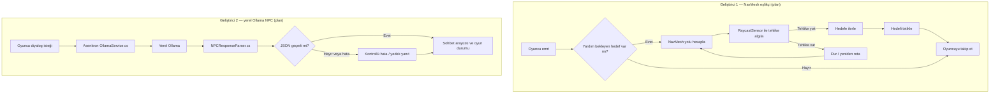
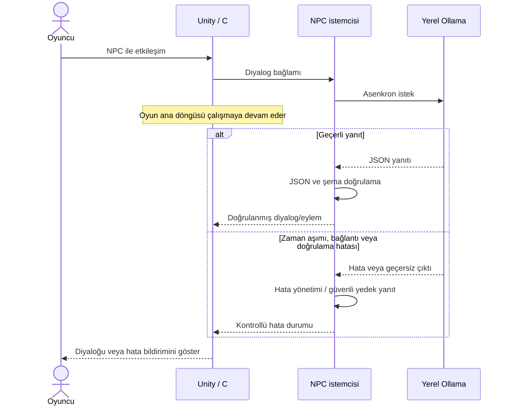

# Unity Otonom Eşlikçi ve LLM NPC — *Lumen*

> **Durum:** Unity projesi iskeleti, ortak arayüzler ve oyun kurgusu oluşturuldu. Eşlikçi, seviye, NPC ve testler henüz tamamlanmamıştır.

## Proje özeti

Unity ve C# ile geliştirilecek bu projede oyuncuya eşlik eden karakter, **NavMesh tabanlı yol bulma** ve açıkça tasarlanmış bir **durum makinesi (FSM)** ile otonom davranacaktır. Eşlikçi, çevresini Raycast tabanlı bir sensörle algılayacak ve rotasını oyun durumuna göre gerçek zamanlı belirleyecektir. NPC diyalogları, aynı bilgisayarda çalışan Ollama üzerindeki yerel bir büyük dil modelinden alınacaktır. Amaç; eşlikçi davranışını sabit komut dizileriyle taklit etmek değil, çevre ve oyun durumuna göre gerçek zamanlı karar verebilen bir sistem kurmaktır.

> Ekip kararı: Pekiştirmeli öğrenme (ML-Agents) kullanılmayacaktır. Doküman NavMesh yaklaşımına izin vermektedir; bu nedenle +10 bonus hedeflenmemektedir.

## Oyun senaryosu

3D, üçüncü şahıs kameralı, yaklaşık 3–5 dakikalık bir demo. Oyuncu karanlık, terk edilmiş bir yeraltı tapınağında kaybolmuştur. Yanında ışık saçan küçük robot **Lumi** vardır.

| Bölüm | Süre (hedef) | İçerik | Sorumlu |
| --- | --- | --- | --- |
| 1. Fiziksel engel | ~1 dk | Köprü kalkıktır, oyuncu uçurumu geçemez. Oyuncu Lumi'ye emir verir; Lumi yalnızca kendi boyunun sığdığı alçak tünelden geçer, açılıp kapanan diken tuzaklarını sensörüyle algılayıp NavMesh üzerinde rotasını yeniden hesaplar, şaltere ulaşır ve köprüyü indirir. | Geliştirici 1 |
| 2. Ara bölge | ~1 dk | Tek odalı kristal galerisi. Oyuncu 3 ışık kristali toplar; her kristal bir meşaleyi yakar ve bekçi hakkında ipucu veren bir yazıt açığa çıkarır. | Geliştirici 1 |
| 3. LLM NPC | ~1,5–2 dk | Çıkış kapısını koruyan taş bekçi **Arven** ile serbest metin diyaloğu. Arven ikna olursa kapı açılır, oyuncu geçer ve oyun sona erer. | Geliştirici 2 |

## Ekip

| Üye | Adı | Sorumluluk / katkı |
| --- | --- | --- |
| Geliştirici 1 | TODO: ad-soyad | NavMesh + FSM tabanlı eşlikçi, oyuncu kontrolü, fiziksel seviye ve ara bölge mekanikleri, ajan testleri |
| Geliştirici 2 | TODO: ad-soyad | Ollama NPC servisi, JSON yanıt işleme, sohbet arayüzü, oyun durumu ve NPC testleri |

İsimler, işlerin gerçek ilerlemesi ve katkı kayıtları TODO olarak bırakılmıştır. Aşağıdaki görevler başlangıç planıdır; tamamlanma durumu değildir.

## Görev dağılımı

### Geliştirici 1 — NavMesh eşlikçi ve seviye mekanikleri

- [ ] `PlayerController.cs` ile oyuncu kontrolünü ve kamerayı geliştirmek.
- [ ] `CompanionController.cs` bileşenini `NavMeshAgent` üzerine kurmak; `Idle`, `Follow`, `MoveToTarget`, `Avoid`, `Interact` durumlarından oluşan durum makinesini (State deseni) uygulamak.
- [ ] `RaycastSensor.cs` ile tehlikelere olan mesafe ve açıyı algılayan sensör tabanlı gözlem mekanizmasını uygulamak.
- [ ] `SwitchMechanism.cs`, `Drawbridge.cs`, `SpikeTrap.cs` ile fiziksel engeli; Lumi'nin sığdığı fakat oyuncunun geçemediği tünel düzenini kurmak.
- [ ] Ara bölge: `CrystalPickup.cs`, meşaleler, yazıtlar ve `LoreJournal.cs`; karanlık ortam ve ışıklandırma.
- [ ] Ajanı farklı başlangıç konumlarında ve tuzak düzenlerinde test etmek; başarı oranı ve ortalama tamamlama süresini belgelemek.
- [ ] Eşlikçi durum makinesini gösteren Mermaid diyagramını rapora eklemek.

### Geliştirici 2 — Ollama NPC ve sohbet arayüzü

- [ ] `OllamaService.cs` içinde yerel Ollama sunucusuna asenkron HTTP isteği, system prompt ve hedef JSON şemasını hazırlamak.
- [ ] `NPCResponseParser.cs` ile JSON yanıtlarını ayrıştırıp doğrulamak; sunucu kapalıyken, zaman aşımında veya bozuk yanıt geldiğinde kontrollü hata davranışını uygulamak.
- [ ] Sohbet arayüzünü ("Düşünüyor..." göstergesi dahil) ve `GameStateManager.cs` bağlantısını geliştirmek.
- [ ] Ollama kapalı senaryosunu test etmek ve en az 5 diyalog örneğini test verisi olarak kaydetmek. Örnekler ve sonuçlar henüz eklenmemiştir.
- [ ] Asenkron istek ve hata yollarını gösteren Mermaid sequence diyagramını rapora eklemek.

## Prefab sahipliği ve Git iş akışı

| Alan | Başlangıç sahibi |
| --- | --- |
| `Companion`, `Obstacle`, `Environment` prefab'ları | Geliştirici 1 |
| `DialogueUI`, `NPC`, `Managers` prefab'ları | Geliştirici 2 |

Prefab sahipliği çakışmaları ekipçe koordine edilmelidir. Özellik dalları `feature/companion-nav` ve `feature/llm-npc` şeklindedir. Değişiklikler gözden geçirilebilir, anlamlı commit'lere bölünecek; test edilen özellikler PR ile `main` dalına alınacaktır. İki geliştiricinin katkısı kod, test ve raporlama işlerinde dengeli tutulacaktır.

## Proje yapısı

```text
Assets/_Project/
  Scripts/
    Core/        Ortak arayüzler (IInteractable, IActivatable, ICompanionTarget, ILoreJournal)
    Player/      Oyuncu kontrolü (Geliştirici 1)
    Companion/   Lumi: NavMesh + FSM + sensör (Geliştirici 1)
    Level/       Şalter, köprü, tuzaklar, kristaller (Geliştirici 1)
    NPC/         Ollama servisi, ayrıştırıcı, bekçi (Geliştirici 2)
    UI/          Sohbet arayüzü (Geliştirici 2)
    Game/        Oyun durumu (Geliştirici 2)
```

Eşlikçi ve NPC birbirine doğrudan bağımlı değildir; yalnızca `Core` içindeki arayüzler üzerinden haberleşir.

## Gereksinimler ve plan

- [x] Unity projesi ve C# oyun bileşenleri için iskelet oluşturuldu.
- [ ] Eşlikçi, NavMesh ve durum makinesi ile sahne ve oyuncu durumuna göre otonom davranacak; hareketi yalnızca önceden yazılmış, sabit bir rota/komut dizisi olmayacak.
- [ ] NPC, Ollama'nın yerel API'sine asenkron istek gönderecek. Uzak bir LLM servisine bağımlılık planlanmamaktadır.
- [ ] Model çıktısı serbest metin olarak doğrudan oyun mantığına bağlanmayacak; doğrulanabilir, yapılandırılmış JSON olarak ayrıştırılacak.
- [ ] İstek zaman aşımı, bağlantı/model hatası, bozuk JSON ve beklenmeyen alanlar ele alınacak. Hata durumunda oyun ana döngüsü takılmayacak; kullanıcıya anlaşılır durum bildirilecek ve güvenli bir yedek yanıt/tekrar deneme davranışı belirlenecek.
- [ ] Sonuçlar gerçek testlerle ölçülecek; tamamlanmamış özellikler ve başarısız testler raporda açıkça belirtilecek.

## NPC JSON taslağı

Bu örnek hedef biçimi gösterir; gerçek şema ve doğrulama kuralları uygulama sırasında kesinleştirilecektir.

```json
{
  "dialogue": "TODO: Arven'in yanıtı",
  "mood": "neutral",
  "trustDelta": 0,
  "action": "none",
  "reason": "TODO: kısa gerekçe"
}
```

- `mood`: `neutral` | `friendly` | `suspicious` | `angry`
- `action`: `none` | `open_door` | `attack`
- `trustDelta`: -20 ile +20 arası tam sayı

Uygulamada geçersiz JSON, tanınmayan `mood`/`action` değerleri ve eksik alanlar reddedilmeli veya güvenli varsayılanlarla ele alınmalıdır. Model yanıtları yürütülebilir talimat olarak değerlendirilmemelidir.

## Taslak ajan akış diyagramı



## Taslak NPC sequence diyagramı



## Test planı ve veri

Testler uygulama tamamlandığında kaydedilecek; aşağıdaki tablo plan şablonudur, sonuç içermez.

| Test | Ölçüt | Veri / senaryo | Sonuç |
| --- | --- | --- | --- |
| Eşlikçi otonomisi | Farklı başlangıç konumlarında şaltere ulaşma; başarı oranı ve ortalama tamamlama süresi | TODO: konum matrisi, tuzak tohumları (seed), deneme sayısı | Bekliyor |
| Sensör ve yeniden rota | Aktif tuzak algılandığında durma/yeniden rota; tuzağa çarpma sayısı | TODO: tuzak zamanlama düzenleri | Bekliyor |
| NPC normal yanıtı | JSON yanıtının ayrıştırılması ve beklenen yanıt/eylemin gösterilmesi | TODO: Ollama modeli, system prompt, JSON şeması ve en az 5 diyalog örneği | Bekliyor |
| Asenkron çalışma | LLM isteği sürerken Unity ana döngüsünün yanıt vermeye devam etmesi | TODO: tekrar sayısı ve ölçüm yöntemi | Bekliyor |
| Hata dayanıklılığı | Ollama sunucusu kapalıyken, zaman aşımında, bozuk JSON veya eksik/yanlış alanlarda kontrollü davranış | TODO: hata enjeksiyonu senaryoları | Bekliyor |

Ölçüm sonuçları, kullanılan Unity/model sürümleri, donanım, test adımları ve gözlemler tamamlandığında eklenecektir.

## Rapor planı

Rapor Markdown biçiminde hazırlanacak; tasarım ve sistem akışları Mermaid diyagramlarıyla gösterilecek. Son rapora gereksinimler, mimari ve yöntem, uygulama ayrıntıları, test ortamı/verileri, ölçümler, sonuçlar ve sınırlılıklar eklenecektir. Bu README'deki diyagramlar başlangıç şablonudur; nihai uygulamayla uyuşacak şekilde güncellenmelidir. Henüz ölçüm veya sonuç iddiası yoktur.

## Başlangıç notları

- Unity sürümü: **6000.6.7f1**. Paketler: `com.unity.ai.navigation` 2.0.16, `com.unity.ugui` 2.6.0, `com.unity.nuget.newtonsoft-json` 3.2.2, `com.unity.test-framework` 1.8.0.
- Girdi sistemi: eski Input Manager.
- NavMesh ajan tipi `Lumi`: yarıçap 0.3 m, yükseklik 0.9 m (oyuncunun sığmadığı tünelden geçebilmesi için).
- Katmanlar: `Player` (8), `Companion` (9), `Hazard` (10), `Interactable` (11).
- Ollama sürümü, model adı ve yerel yapılandırma: TODO.
- Ekran görüntüleri, test kayıtları, en az 5 diyalog örneği ve rapor bağlantıları: TODO.
