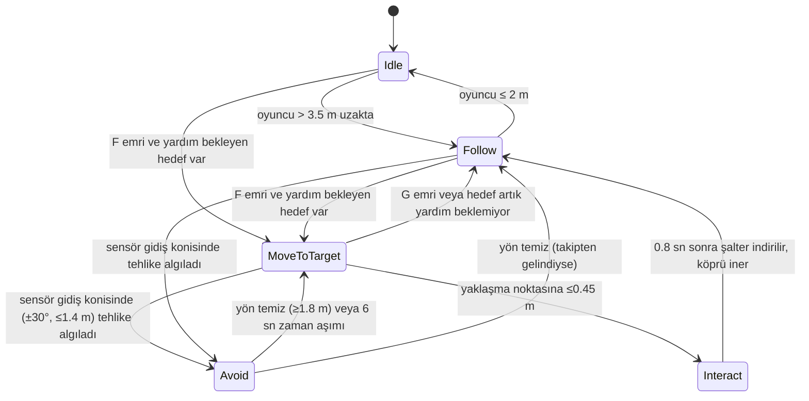
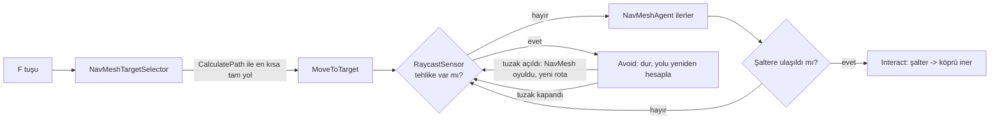
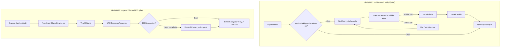
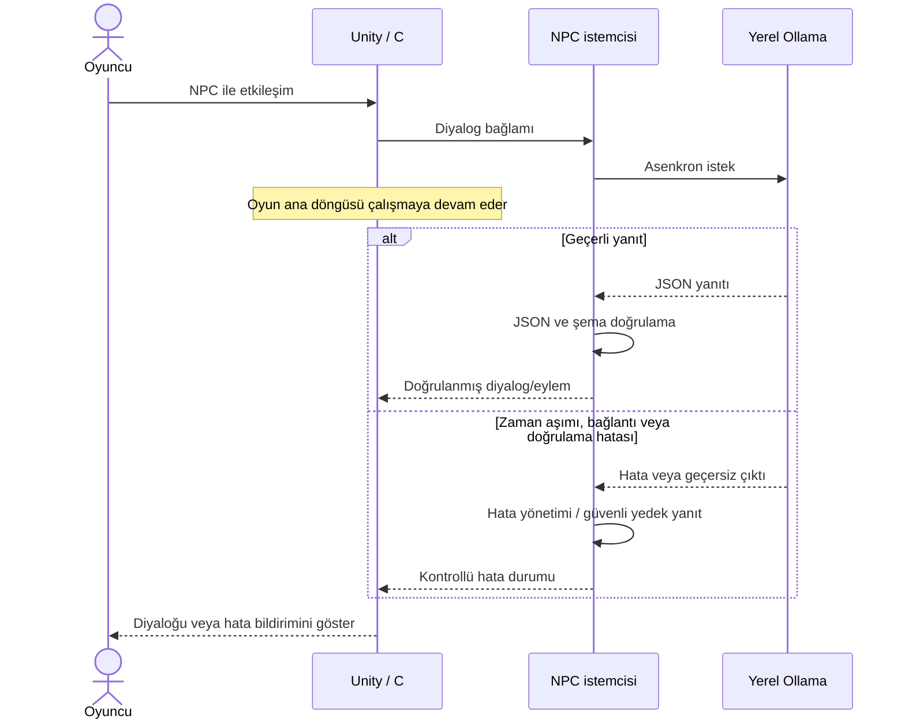

# Unity Otonom Eşlikçi ve LLM NPC — *Lumen*

> **Durum:** 1. bölüm (oyuncu, NavMesh + FSM eşlikçi Lumi, tuzak odası, şalter ve köprü) ile eşlikçi testleri tamamlandı. Ara bölge, LLM NPC ve oyun sonu henüz tamamlanmamıştır.

## Proje özeti

Unity ve C# ile geliştirilecek bu projede oyuncuya eşlik eden karakter, **NavMesh tabanlı yol bulma** ve açıkça tasarlanmış bir **durum makinesi (FSM)** ile otonom davranacaktır. Eşlikçi, çevresini Raycast tabanlı bir sensörle algılayacak ve rotasını oyun durumuna göre gerçek zamanlı belirleyecektir. NPC diyalogları, aynı bilgisayarda çalışan Ollama üzerindeki yerel bir büyük dil modelinden alınacaktır. Amaç; eşlikçi davranışını sabit komut dizileriyle taklit etmek değil, çevre ve oyun durumuna göre gerçek zamanlı karar verebilen bir sistem kurmaktır.

> Ekip kararı: Pekiştirmeli öğrenme (ML-Agents) kullanılmayacaktır. Doküman NavMesh yaklaşımına izin vermektedir; bu nedenle +10 bonus hedeflenmemektedir.

## Oyun senaryosu

3D, üçüncü şahıs kameralı, yaklaşık 3–5 dakikalık bir demo. Oyuncu karanlık, terk edilmiş bir yeraltı tapınağında kaybolmuştur. Yanında ışık saçan küçük robot **Lumi** vardır.

| Bölüm | Süre (hedef) | İçerik | Sorumlu |
| --- | --- | --- | --- |
| 1. Fiziksel engel | ~1 dk | Köprü kalkıktır, oyuncu uçurumu geçemez. Oyuncu Lumi'ye emir verir; Lumi yalnızca kendi boyunun sığdığı alçak tünelden geçer, açılıp kapanan diken tuzaklarını sensörüyle algılayıp NavMesh üzerinde rotasını yeniden hesaplar, şaltere ulaşır ve köprüyü indirir. | Geliştirici 1 |
| 2. Ara bölge | ~1 dk | Tek odalı kristal galerisi. Oyuncu 3 ışık kristali toplar; her kristal bir meşaleyi yakar ve bekçi hakkında ipucu veren bir yazıt açığa çıkarır. | Geliştirici 1 |
| 3. LLM NPC | ~1,5–2 dk | Çıkış kapısını koruyan taş bekçi **Arven** ile serbest metin diyaloğu. Arven ikna olursa kapı açılır, oyuncu geçer ve oyun sona erer. | Geliştirici 2 |

## Ekip

| Üye | Adı | Sorumluluk / katkı |
| --- | --- | --- |
| Geliştirici 1 | TODO: ad-soyad | NavMesh + FSM tabanlı eşlikçi, oyuncu kontrolü, fiziksel seviye ve ara bölge mekanikleri, ajan testleri |
| Geliştirici 2 | TODO: ad-soyad | Ollama NPC servisi, JSON yanıt işleme, sohbet arayüzü, oyun durumu ve NPC testleri |

İsimler TODO olarak bırakılmıştır. Aşağıdaki listede işaretli maddeler tamamlanmıştır, işaretsizler henüz yapılmamıştır.

## Görev dağılımı

### Geliştirici 1 — NavMesh eşlikçi ve seviye mekanikleri

- [x] `PlayerController.cs` ile oyuncu kontrolünü ve kamerayı geliştirmek.
- [x] `CompanionController.cs` bileşenini `NavMeshAgent` üzerine kurmak; `Idle`, `Follow`, `MoveToTarget`, `Avoid`, `Interact` durumlarından oluşan durum makinesini (State deseni) uygulamak.
- [x] `RaycastSensor.cs` ile tehlikelere olan mesafe ve açıyı algılayan sensör tabanlı gözlem mekanizmasını uygulamak.
- [x] `SwitchMechanism.cs`, `Drawbridge.cs`, `SpikeTrap.cs` ile fiziksel engeli; Lumi'nin sığdığı fakat oyuncunun geçemediği geçit düzenini kurmak.
- [ ] Ara bölge: `CrystalPickup.cs`, meşaleler, yazıtlar ve `LoreJournal.cs`; karanlık ortam ve ışıklandırma.
- [x] Ajanı farklı başlangıç konumlarında ve tuzak düzenlerinde test etmek; başarı oranı ve ortalama tamamlama süresini belgelemek.
- [x] Eşlikçi durum makinesini gösteren Mermaid diyagramını rapora eklemek.

### Geliştirici 2 — Ollama NPC ve sohbet arayüzü

- [ ] `OllamaService.cs` içinde yerel Ollama sunucusuna asenkron HTTP isteği, system prompt ve hedef JSON şemasını hazırlamak.
- [ ] `NPCResponseParser.cs` ile JSON yanıtlarını ayrıştırıp doğrulamak; sunucu kapalıyken, zaman aşımında veya bozuk yanıt geldiğinde kontrollü hata davranışını uygulamak.
- [ ] Sohbet arayüzünü ("Düşünüyor..." göstergesi dahil) ve `GameStateManager.cs` bağlantısını geliştirmek.
- [ ] Ollama kapalı senaryosunu test etmek ve en az 5 diyalog örneğini test verisi olarak kaydetmek. Örnekler ve sonuçlar henüz eklenmemiştir.
- [ ] Asenkron istek ve hata yollarını gösteren Mermaid sequence diyagramını rapora eklemek.

## Prefab sahipliği ve Git iş akışı

| Alan | Başlangıç sahibi |
| --- | --- |
| `Companion`, `Obstacle`, `Environment` prefab'ları | Geliştirici 1 |
| `DialogueUI`, `NPC`, `Managers` prefab'ları | Geliştirici 2 |

Prefab sahipliği çakışmaları ekipçe koordine edilmelidir. Özellik dalları `feature/companion-nav` ve `feature/llm-npc` şeklindedir. Değişiklikler gözden geçirilebilir, anlamlı commit'lere bölünecek; test edilen özellikler PR ile `main` dalına alınacaktır. İki geliştiricinin katkısı kod, test ve raporlama işlerinde dengeli tutulacaktır.

## Proje yapısı

```text
Assets/_Project/
  Scripts/
    Core/        Ortak arayüzler (IInteractable, IActivatable, ICompanionTarget, ILoreJournal)
    Player/      Oyuncu kontrolü (Geliştirici 1)
    Companion/   Lumi: NavMesh + FSM + sensör (Geliştirici 1)
    Level/       Şalter, köprü, tuzaklar, kristaller (Geliştirici 1)
    NPC/         Ollama servisi, ayrıştırıcı, bekçi (Geliştirici 2)
    UI/          Sohbet arayüzü (Geliştirici 2)
    Game/        Oyun durumu (Geliştirici 2)
```

Eşlikçi ve NPC birbirine doğrudan bağımlı değildir; yalnızca `Core` içindeki arayüzler üzerinden haberleşir.

### Sahne üretimi

`Assets/_Project/Scenes/Lumen.unity` elle düzenlenmez; **Lumen → Sahneyi Yeniden Oluştur** menüsüyle `Assets/_Project/Editor/SceneBuilding` altındaki bölüm sınıflarından (`ISceneSection`) üretilir ve NavMesh otomatik pişirilir. Her geliştirici yalnızca kendi bölüm sınıfını değiştirdiği için `.unity` dosyasında birleştirme çakışması oluşmaz.

| Bölüm sınıfı | Sıra | Sahip |
| --- | --- | --- |
| `EnvironmentSection` (salon, tuzak odası, şalter, uçurum, köprü) | 0 | Geliştirici 1 |
| `PlayerSection` (oyuncu, kamera) | 10 | Geliştirici 1 |
| `CompanionSection` (Lumi, `Companion_Prefab`) | 20 | Geliştirici 1 |
| `HudSection` (HUD, EventSystem) | 30 | Geliştirici 1 |

Komut satırından: `Unity.exe -batchmode -projectPath . -executeMethod Lumen.EditorTools.SceneBuilding.LumenSceneBuilder.BuildFromCommandLine`

## Otonom eşlikçi (Lumi) — karar mekanizması

Lumi bir `NavMeshAgent` ile hareket eder; her karede durum makinesinin aktif durumu çalışır. Hiçbir rota elle yazılmamıştır: hedef seçimi `NavMesh.CalculatePath` ile ölçülen gerçek yol uzunluğuna, ilerleme ise NavMesh yoluna ve sensör okumalarına göre yapılır.

- **Fiziksel engel:** Köprü kalkıktır. Şalter, salondan demir parmaklıklarla ayrılmış tuzak odasındadır. Parmaklıklardaki tek geçidin üstü 1,1 m'de kapanır: Lumi (NavMesh ajan tipi `Lumi`, yükseklik 0,9 m) geçebilir, oyuncu (1,8 m) geçemez.
- **Tuzaklar:** Odadaki iki sıra duvarın geçitlerinde 5 diken tuzağı vardır. Her tuzak `Kapalı → Uyarı (0,6 sn, turuncu) → Açık` döngüsüyle, tohumlu rastgele sürelerle çalışır. Açıkken `NavMeshObstacle` ile NavMesh'i oyar; bu sayede yol, açık geçitlerden yeniden hesaplanır.
- **Sensör:** `RaycastSensor`, gidiş yönü etrafında 90°'lik yelpazeye 9 ışın gönderir (menzil 3,5 m). Her okuma tehlikeye olan **mesafeyi** ve **açıyı** içerir; duvarlar ışınları keser. Uyarı aşamasındaki tuzak henüz NavMesh'i oymadığı için, onu yalnızca sensör fark edebilir.





Tuzağa yakalanırsa (`OnHazardHit`) Lumi geçidin hemen içine geri konumlanır ve görevi sürdürür; bu sayı testlerde raporlanır.

## Gereksinimler ve plan

- [x] Unity projesi ve C# oyun bileşenleri için iskelet oluşturuldu.
- [ ] Eşlikçi, NavMesh ve durum makinesi ile sahne ve oyuncu durumuna göre otonom davranacak; hareketi yalnızca önceden yazılmış, sabit bir rota/komut dizisi olmayacak.
- [ ] NPC, Ollama'nın yerel API'sine asenkron istek gönderecek. Uzak bir LLM servisine bağımlılık planlanmamaktadır.
- [ ] Model çıktısı serbest metin olarak doğrudan oyun mantığına bağlanmayacak; doğrulanabilir, yapılandırılmış JSON olarak ayrıştırılacak.
- [ ] İstek zaman aşımı, bağlantı/model hatası, bozuk JSON ve beklenmeyen alanlar ele alınacak. Hata durumunda oyun ana döngüsü takılmayacak; kullanıcıya anlaşılır durum bildirilecek ve güvenli bir yedek yanıt/tekrar deneme davranışı belirlenecek.
- [ ] Sonuçlar gerçek testlerle ölçülecek; tamamlanmamış özellikler ve başarısız testler raporda açıkça belirtilecek.

## NPC JSON taslağı

Bu örnek hedef biçimi gösterir; gerçek şema ve doğrulama kuralları uygulama sırasında kesinleştirilecektir.

```json
{
  "dialogue": "TODO: Arven'in yanıtı",
  "mood": "neutral",
  "trustDelta": 0,
  "action": "none",
  "reason": "TODO: kısa gerekçe"
}
```

- `mood`: `neutral` | `friendly` | `suspicious` | `angry`
- `action`: `none` | `open_door` | `attack`
- `trustDelta`: -20 ile +20 arası tam sayı

Uygulamada geçersiz JSON, tanınmayan `mood`/`action` değerleri ve eksik alanlar reddedilmeli veya güvenli varsayılanlarla ele alınmalıdır. Model yanıtları yürütülebilir talimat olarak değerlendirilmemelidir.

## Taslak ajan akış diyagramı



## Taslak NPC sequence diyagramı



## Test planı ve veri

Eşlikçi testleri Unity Test Framework PlayMode testleriyle (`Assets/_Project/Tests/PlayMode/CompanionNavigationTests.cs`) otomatik çalıştırılır. Diğer satırlar henüz plan şablonudur.

| Test | Ölçüt | Veri / senaryo | Sonuç |
| --- | --- | --- | --- |
| Eşlikçi otonomisi | Farklı başlangıç konumlarında şaltere ulaşma; başarı oranı ve ortalama tamamlama süresi | 10 başlangıç noktası × 3 tuzak tohumu (11, 23, 37) = 30 deneme, deneme başına 60 sn sınır | **Geçti** — 30/30 (%100), ort. 9,94 sn |
| Sensör ve yeniden rota | Aktif tuzak algılandığında durma/yeniden rota; tuzağa çarpma sayısı | Aynı 30 deneme | **Geçti** — 0 yakalanma, deneme başına ort. 0,7 Avoid geçişi |
| Köprüden geçiş | Şalter sonrası Lumi'nin inen köprüden geçip karşı taraftaki oyuncuya ulaşması | Tohum 5, oyuncu z=32'ye taşınır, 40 sn sınır | **Geçti** |
| NPC normal yanıtı | JSON yanıtının ayrıştırılması ve beklenen yanıt/eylemin gösterilmesi | TODO: Ollama modeli, system prompt, JSON şeması ve en az 5 diyalog örneği | Bekliyor |
| Asenkron çalışma | LLM isteği sürerken Unity ana döngüsünün yanıt vermeye devam etmesi | TODO: tekrar sayısı ve ölçüm yöntemi | Bekliyor |
| Hata dayanıklılığı | Ollama sunucusu kapalıyken, zaman aşımında, bozuk JSON veya eksik/yanlış alanlarda kontrollü davranış | TODO: hata enjeksiyonu senaryoları | Bekliyor |

#### Eşlikçi test sonuçları (2026-10-27, Unity 6000.6.7f1, batch modu, `Time.timeScale = 3`)

| Ölçüt | Değer |
| --- | --- |
| Deneme sayısı | 30 (10 başlangıç noktası × 3 tuzak tohumu) |
| Başarı oranı | %100 (30/30) |
| Ortalama tamamlama süresi | 9,94 sn (oyun zamanı) |
| En kısa / en uzun süre | 6,83 / 14,00 sn |
| Toplam tuzağa yakalanma | 0 |
| Deneme başına ortalama Avoid geçişi | 0,7 |

Deneme bazında ham veri: [`TestResults/companion_trials.csv`](TestResults/companion_trials.csv). Testleri yeniden çalıştırmak için Unity'de **Window → General → Test Runner → PlayMode → Run All** ya da komut satırından `Unity.exe -batchmode -projectPath . -runTests -testPlatform PlayMode`.

Sınırlılık: Testler sahnenin geometrisi sabitken başlangıç konumunu ve tuzak zamanlamasını değiştirir; farklı oda düzenleri denenmemiştir. NPC ölçüm sonuçları ve model sürümleri tamamlandığında eklenecektir.

## Rapor planı

Rapor Markdown biçiminde hazırlanacak; tasarım ve sistem akışları Mermaid diyagramlarıyla gösterilecek. Son rapora gereksinimler, mimari ve yöntem, uygulama ayrıntıları, test ortamı/verileri, ölçümler, sonuçlar ve sınırlılıklar eklenecektir. Bu README'deki diyagramlar başlangıç şablonudur; nihai uygulamayla uyuşacak şekilde güncellenmelidir. Henüz ölçüm veya sonuç iddiası yoktur.

## Başlangıç notları

- Unity sürümü: **6000.6.7f1**. Paketler: `com.unity.ai.navigation` 2.0.16, `com.unity.ugui` 2.6.0, `com.unity.nuget.newtonsoft-json` 3.2.2, `com.unity.test-framework` 1.8.0.
- Girdi sistemi: eski Input Manager. Kontroller: WASD hareket, fare kamera, **F** Lumi'den yardım iste, **G** Lumi takip etsin, **E** etkileşim.
- Projeyi ilk açışta sahne yoksa: **Lumen → Sahneyi Yeniden Oluştur**, ardından `Assets/_Project/Scenes/Lumen.unity` açılıp Play.
- NavMesh ajan tipi `Lumi`: yarıçap 0.3 m, yükseklik 0.9 m (oyuncunun sığmadığı tünelden geçebilmesi için).
- Katmanlar: `Player` (8), `Companion` (9), `Hazard` (10), `Interactable` (11).
- Ollama sürümü, model adı ve yerel yapılandırma: TODO.
- Ekran görüntüleri, test kayıtları, en az 5 diyalog örneği ve rapor bağlantıları: TODO.
