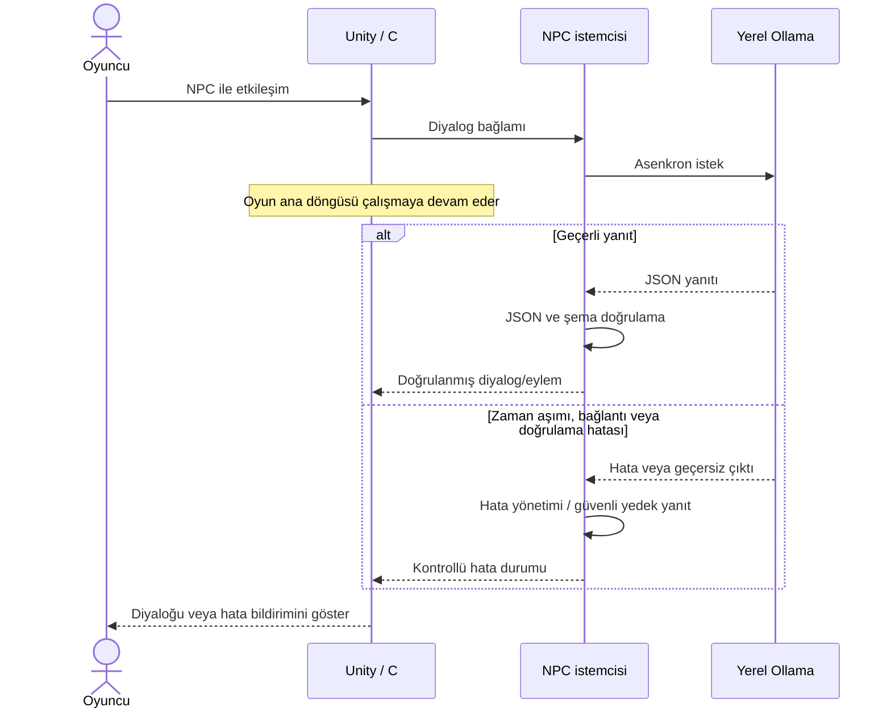

# Unity Otonom Eşlikçi ve LLM NPC

> **Durum:** Raporlar analiz edildi; yol haritası ve görev dağılımı için hazırlıklara başlandı. Uygulama, deneyler ve sonuçlar henüz tamamlanmamıştır.

## Proje özeti

Unity ve C# ile geliştirilecek bu projede oyuncuya eşlik eden karakter, ML-Agents tabanlı otonom bir yaklaşımla eğitilecektir. NPC diyalogları, aynı bilgisayarda çalışan Ollama üzerindeki yerel bir büyük dil modelinden alınacaktır. Amaç; eşlikçi davranışını sabit komut dizileriyle taklit etmek değil, çevre ve oyun durumuna göre gerçek zamanlı karar verebilen bir sistem kurmaktır.

## Ekip

| Üye | Adı | Sorumluluk / katkı |
| --- | --- | --- |
| Geliştirici 1 | TODO: ad-soyad | ML-Agents tabanlı eşlikçi, oyuncu kontrolü, fiziksel seviye mekanikleri ve ajan testleri |
| Geliştirici 2 | TODO: ad-soyad | Ollama NPC servisi, JSON yanıt işleme, sohbet arayüzü ve NPC testleri |

İsimler, işlerin gerçek ilerlemesi ve katkı kayıtları TODO olarak bırakılmıştır. Aşağıdaki görevler başlangıç planıdır; tamamlanma durumu değildir.

## Görev dağılımı

### Geliştirici 1 — ML-Agents eşlikçi ve seviye mekanikleri

- [ ] Python ortamını ve `mlagents-learn` eğitim akışını hazırlamak; `trainer_config.yaml` ayarlarını oluşturmak.
- [ ] `CompanionAgent.cs` bileşenini, `RayPerceptionSensor3D` gözlemlerini, ajan eylemlerini ve ödül fonksiyonunu tasarlayıp uygulamak.
- [ ] TensorBoard eğitim sonuçlarını bonus belgeleme gereksinimi için kaydetmek ve raporlamak. Eğitim sonuçları henüz yoktur.
- [ ] `PlayerController.cs` ile oyuncu kontrolünü ve fiziksel seviye etkileşimlerini geliştirmek; `SwitchMechanism.cs`, `ObstacleTrigger.cs`, ışıklandırma ve prefab'ları eklemek.
- [ ] Ajanı farklı başlangıç ve oyuncu konumlarında test etmek; test sahnelerini, ölçümleri ve sonuçları belgelemek.
- [ ] Gözlem, eylem, ödül ve eğitim döngüsünü gösteren Mermaid ajan diyagramını rapora eklemek.

### Geliştirici 2 — Ollama NPC ve sohbet arayüzü

- [ ] `OllamaService.cs` içinde yerel Ollama sunucusuna asenkron HTTP isteği, system prompt ve hedef JSON şemasını hazırlamak.
- [ ] `NPCResponseParser.cs` ile JSON yanıtlarını ayrıştırıp doğrulamak; sunucu kapalıyken, zaman aşımında veya bozuk yanıt geldiğinde kontrollü hata davranışını uygulamak.
- [ ] Sohbet arayüzünü ve `GameStateManager.cs` bağlantısını geliştirmek.
- [ ] Ollama kapalı senaryosunu test etmek ve en az 5 diyalog örneğini test verisi olarak kaydetmek. Örnekler ve sonuçlar henüz eklenmemiştir.
- [ ] Asenkron istek ve hata yollarını gösteren Mermaid sequence diyagramını rapora eklemek.

## Prefab sahipliği ve Git iş akışı

| Alan | Başlangıç sahibi |
| --- | --- |
| `Companion`, `Obstacle`, `Environment` prefab'ları | Geliştirici 1 |
| `DialogueUI`, `NPC`, `Managers` prefab'ları | Geliştirici 2 |

Prefab sahipliği çakışmaları ekipçe koordine edilmelidir. Planlanan özellik dalları `feature/companion-ml` ve `feature/llm-npc` şeklindedir. Değişiklikler gözden geçirilebilir, anlamlı commit'lere bölünecek; test edilen özellikler PR ile `main` dalına alınacaktır. İki geliştiricinin katkısı kod, test ve raporlama işlerinde dengeli tutulacaktır.

## Gereksinimler ve plan

- [ ] Unity projesi ve C# oyun bileşenleri oluşturulacak.
- [ ] Eşlikçi, ML-Agents ile sahne ve oyuncu durumuna göre otonom davranacak; hareketi yalnızca önceden yazılmış, sabit bir rota/komut dizisi olmayacak.
- [ ] NPC, Ollama'nın yerel API'sine asenkron istek gönderecek. Uzak bir LLM servisine bağımlılık planlanmamaktadır.
- [ ] Model çıktısı serbest metin olarak doğrudan oyun mantığına bağlanmayacak; doğrulanabilir, yapılandırılmış JSON olarak ayrıştırılacak.
- [ ] İstek zaman aşımı, bağlantı/model hatası, bozuk JSON ve beklenmeyen alanlar ele alınacak. Hata durumunda oyun ana döngüsü takılmayacak; kullanıcıya anlaşılır durum bildirilecek ve güvenli bir yedek yanıt/tekrar deneme davranışı belirlenecek.
- [ ] Sonuçlar gerçek testlerle ölçülecek; tamamlanmamış özellikler ve başarısız testler raporda açıkça belirtilecek.

## NPC JSON taslağı

Bu örnek hedef biçimi gösterir; gerçek şema ve doğrulama kuralları uygulama sırasında belirlenecektir.

```json
{
  "dialogue": "TODO: NPC yanıtı",
  "mood": "neutral",
  "action": "follow",
  "reason": "TODO: kısa gerekçe"
}
```

Uygulamada geçersiz JSON, tanınmayan `mood`/`action` değerleri ve eksik alanlar reddedilmeli veya güvenli varsayılanlarla ele alınmalıdır. Model yanıtları yürütülebilir talimat olarak değerlendirilmemelidir.

## Taslak ajan akış diyagramı

```mermaid
flowchart TD
    subgraph Ajan["Geliştirici 1 — ML-Agents eşlikçi (plan)"]
        A[Oyuncu, çevre ve engeller] --> B[RayPerceptionSensor3D gözlemleri]
        B --> C[CompanionAgent.cs]
        C --> D[Eylemler ve hareket]
        D --> E[Fiziksel seviye mekanikleri]
        E --> F[Ödül fonksiyonu]
        F --> G[mlagents-learn ve trainer_config.yaml]
        G --> C
    end
    subgraph NPC["Geliştirici 2 — yerel Ollama NPC (plan)"]
        H[Oyuncu diyalog isteği] --> I[Asenkron OllamaService.cs]
        I --> J[Yerel Ollama]
        J --> K[NPCResponseParser.cs]
        K --> L{JSON geçerli mi?}
        L -->|Evet| M[Sohbet arayüzü ve oyun durumu]
        L -->|Hayır veya hata| N[Kontrollü hata / yedek yanıt]
        N --> M
    end
```



## Taslak NPC sequence diyagramı



## Test planı ve veri

Testler uygulama tamamlandığında kaydedilecek; aşağıdaki tablo plan şablonudur, sonuç içermez.

| Test | Ölçüt | Veri / senaryo | Sonuç |
| --- | --- | --- | --- |
| Eşlikçi otonomisi | Farklı başlangıç ve oyuncu konumlarında uygun ajan hareketi ve engel davranışı; sabit komut dizisine bağlı olmama | TODO: konum matrisi, sahne ve engel düzeni | Bekliyor |
| ML-Agents eğitimi | Gözlem, eylem ve ödül döngüsünün çalışması; eğitim kayıtlarının incelenmesi | TODO: `trainer_config.yaml`, eğitim adımları ve TensorBoard kayıtları | Bekliyor |
| NPC normal yanıtı | JSON yanıtının ayrıştırılması ve beklenen yanıt/eylemin gösterilmesi | TODO: Ollama modeli, system prompt, JSON şeması ve en az 5 diyalog örneği | Bekliyor |
| Asenkron çalışma | LLM isteği sürerken Unity ana döngüsünün yanıt vermeye devam etmesi | TODO: tekrar sayısı ve ölçüm yöntemi | Bekliyor |
| Hata dayanıklılığı | Ollama sunucusu kapalıyken, zaman aşımında, bozuk JSON veya eksik/yanlış alanlarda kontrollü davranış | TODO: hata enjeksiyonu senaryoları | Bekliyor |

Ölçüm sonuçları, kullanılan Unity/model sürümleri, donanım, test adımları ve gözlemler tamamlandığında eklenecektir.

## Rapor planı

Rapor Markdown biçiminde hazırlanacak; tasarım ve sistem akışları Mermaid diyagramlarıyla gösterilecek. Son rapora gereksinimler, mimari ve yöntem, uygulama ayrıntıları, test ortamı/verileri, ölçümler, sonuçlar ve sınırlılıklar eklenecektir. Bu README'deki diyagramlar başlangıç şablonudur; nihai uygulamayla uyuşacak şekilde güncellenmelidir. Henüz ölçüm veya sonuç iddiası yoktur.

## Başlangıç notları

- Unity, C# ve gerekli paket/sürüm bilgileri: TODO.
- ML-Agents/Python ortamı ve eğitim yapılandırması: TODO.
- Ollama sürümü, model adı ve yerel yapılandırma: TODO.
- Ekran görüntüleri, test kayıtları, en az 5 diyalog örneği, TensorBoard belgelemesi ve rapor bağlantıları: TODO.
